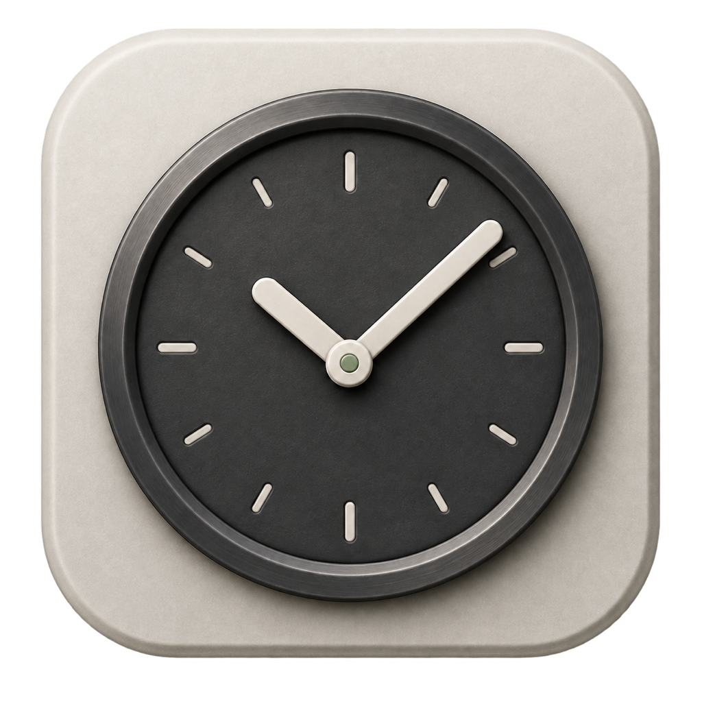

# TaskTick

<p align="center">
  
</p>

<h3 align="center">TaskTick 定时任务</h3>

<p align="center">
  <strong>macOS 原生定时任务管理应用</strong><br>
  无需 crontab，无需 launchd，交给 TaskTick。
</p>

<p align="center">
  <a href="https://github.com/iuxt/TaskTick/releases/latest"></a>
  <a href="https://github.com/iuxt/TaskTick/releases"></a>
  
  <a href="https://www.gnu.org/licenses/gpl-3.0.html"></a>
</p>

<p align="center">
  <a href="https://github.com/iuxt/TaskTick/releases/latest">⬇️ <strong>点击下载最新版本</strong></a>
</p>

<p align="center">
  <a href="https://iuxt.github.io/TaskTick/">官网</a> ·
  <a href="https://iuxt.github.io/TaskTick/guide/">使用文档</a> ·
  <a href="README.md">English</a>
</p>

---

<p align="center">
  
</p>

## 功能特色

- **菜单栏常驻** — 后台静默运行，菜单栏随时访问
- **灵活调度** — 日期、时间、重复周期，类似提醒事项的直观设置
- **脚本执行** — 内联脚本或本地文件（.sh、.py、.rb、.js）
- **执行日志** — 捕获 stdout/stderr、退出码、执行耗时
- **后台程序管理** — 启停和重启长驻命令，支持随应用启动、异常自动拉起、stdout/stderr 文件输出与按大小轮转
- **系统通知** — 任务成功或失败时推送 macOS 原生通知（支持按任务配置）
- **Crontab 导入** — 一键导入系统 crontab 任务
- **中英双语** — 支持中英文界面，App 内一键切换
- **支持 macOS 26** — 液态玻璃视觉特效，旧系统优雅降级

## 系统要求

### 后台程序

创建后台进程后，可以在编辑器的“设置”页配置重启策略、日志路径、单文件大小和历史文件数量。

详情页和右键菜单中的“开机自启动”开关控制登录系统后是否自动运行该进程；开启时会同时启用 TaskTick 的开机启动。关闭开关不会停止当前进程，运行和停止由对应按钮单独控制。编辑器的“基本”页提供相同的自启动设置。

### 日志文件

定时任务每次执行都会在 `~/Library/Logs/TaskTick/com.iuxt.TaskTick/<任务名>/` 下生成一个独立的 `.log` 文件，与“最近执行”中的记录对应。详情页可打开日志文件夹，单条执行记录可在 Finder 中显示对应文件。任务名中不能用于文件夹名称的字符会替换为 `-`。

定时任务的“清空日志”会删除已结束执行的 `.log` 文件和“最近执行”记录，并清空界面中的输出；用于调度的累计执行次数保持不变。正在执行的记录会保留，其日志文件原地清空后继续写入新输出。手动任务和后台进程会原地清空日志文件内容（包含轮转文件）。删除执行记录或清理过期日志时，对应文件也会删除。

- macOS 14 (Sonoma) 或更高版本
- Apple Silicon 或 Intel Mac

## 安装

### Homebrew（推荐）

```bash
brew tap iuxt/tap
brew install --cask task-tick
```

更新到最新版本：

```bash
brew upgrade --cask task-tick
```

### 下载

从 [Releases](https://github.com/iuxt/TaskTick/releases) 下载最新 `.dmg`：

| 文件 | 架构 |
|------|------|
| `TaskTick-3-arm64.dmg` | Apple Silicon (M1/M2/M3/M4) |
| `TaskTick-3-x86_64.dmg` | Intel Mac |

从 `3` 开始，发布标签依次使用整数（`3`、`4`、`5`……），不带 `v` 前缀或小数点。上表以版本 `3` 的文件名为例。

标记为 **Signed & Notarized** 的 Release 使用 Developer ID 签名并经过 Apple 公证，
拖入“应用程序”后可直接打开。没有 Apple Developer 证书的 ad-hoc 版本首次打开时可能需要
**右键点击 TaskTick.app → 打开 → 打开**，或执行：

```bash
xattr -cr /Applications/TaskTick.app
```

### 从源码构建

```bash
git clone https://github.com/iuxt/TaskTick.git
cd TaskTick
./build.sh
```

脚本会先退出正在运行的 TaskTick，构建本机架构的 Release 版本，安装到 `/Applications/TaskTick.app`，清理临时文件并自动启动。首次构建需要安装 Xcode 或 Xcode Command Line Tools；安装目录不可写时会请求管理员密码。

## 官网开发

官网使用 Hugo 渲染，通过 GitHub Actions 自动部署到 GitHub Pages。
本地预览、文案修改和部署方式见[官网开发文档](docs/WEBSITE.md)。

## 开源协议

GPL-3.0 © [iuxt](https://github.com/iuxt)
